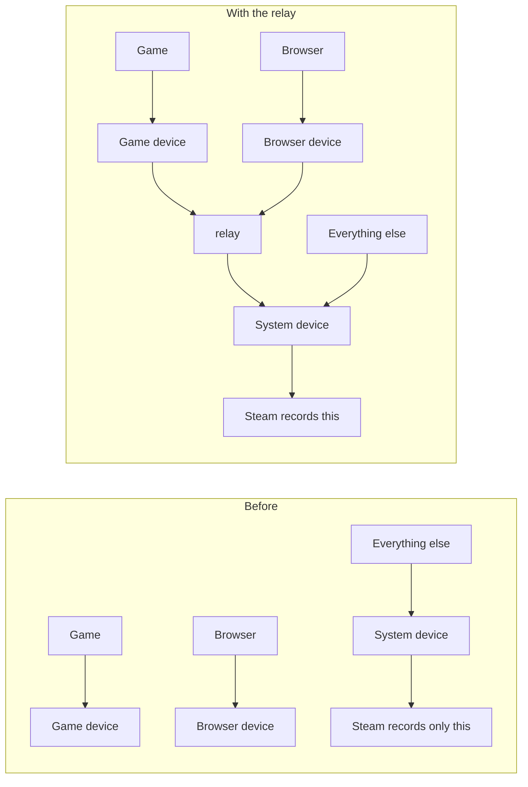

# steam-audio-relay

A small Windows tool for one specific problem. You stream games from your PC with Steam Remote Play (to a Steam Deck, a phone, a laptop), you use Elgato Wave Link on the PC, and on the other end you only hear the "System" channel. Game, browser, voice chat: nothing.

This tool puts all of those channels back into the one place Steam listens. It is a single C# file with no dependencies, and it builds with the compiler that comes with Windows. There is a small window and a tray icon, and a command line mode if you want that.


## What was going on

Steam records exactly one playback device on the PC: the Windows default playback device. You can see it in `Steam\logs\streaming_log.txt` while a stream is running:

```
[System Windows] Recording on device: System (Elgato Wave XLR Pro)
```

Wave Link gives every channel (System, Game, Browser, Voice chat and so on) its own Windows playback device, and routes your programs to them. The Windows default is the "System" one. So Steam records "System" and nothing else. Whatever plays on the Game or Browser device never reaches it.

OBS was fine the whole time, because it takes a Wave Link mix directly. That is why this took me weeks to work out. Everything sounded right on the PC, and everything sounded right in the recording.



## What the tool does

It listens to every other playback device that belongs to the same driver as "System". With Wave Link, those are the channel devices. (Technically this is called WASAPI loopback: Windows lets a program copy what a playback device is playing.) It mixes them and plays the result into "System". Steam records "System", and now it gets everything.

It only does this while Steam is actually recording that device. While a stream runs, `steam.exe` holds an active audio session on the device it records, and Windows will tell you about it. The tool checks twice a second. It starts about a second after the client connects, and it pauses 3 seconds after Steam stops recording. I compared this against Steam's own log over 25 minutes with several connects, disconnects, alt-tabs and game starts, and every change matched. It stayed on through all the switching between desktop and game. If the sessions can't be read, it falls back to parsing Steam's log.

One thing to know: when you start a game from the client's library, Steam ends the stream and starts a new one 5 to 10 seconds later. The relay pauses in that gap, because Steam records nothing then, and picks up again afterwards.

Nothing needs to be set up in Wave Link's mixes. No mix has to send anything anywhere special and nothing has to be muted. The channel devices are tapped before Wave Link's mixer, so nothing can loop back into itself.

## Setup

1. Run `build.cmd`. It uses `csc.exe` from .NET Framework 4, which is already on Windows 10 and 11, so you don't need an SDK. You get two exes: `steam-audio-relay.exe` (the window) and `steam-audio-relay-cli.exe` (for the terminal). I'd rather you build it yourself than download an exe from a stranger, and the source is short enough to read.

2. In Wave Link, open Settings, then Audio devices, then "Lock system devices", and lock the output device to "System". Leave it on. The wording may differ in your version or language, mine is German. This matters: with the lock off, Steam switches the Windows default to its own "Steam Streaming Speakers" when a client connects, and every program that isn't assigned to a Wave Link channel goes silent.

3. Start `steam-audio-relay.exe`, check that the target is right (see below), and switch on "Start with Windows" if you want. Then connect from your Deck or phone.

## The window

Top right is the Start/Stop button. Closing the window hides it in the tray, and "Exit" in the tray menu really quits. "Refresh" reads the device list again, for example after you added a channel in Wave Link.

**Stream volume.** One row per channel: a mute button, a slider with a level meter inside it, and a percentage. These sliders set how loud that channel is in the stream. They change nothing in Wave Link and nothing at your desk.

**Plays into (the device Steam records).** A dropdown for the target. If exactly one device is called "System", it is picked for you. Next to it is a meter showing the finished mix, so you can see whether signal arrives at all.

**Options.**

- Full volume in the stream. Explained in the next section.
- Only while streaming. On by default. Off means the relay runs all the time.
- Start with Windows. Writes an entry under `HKCU\...\Run` that starts the tool with `--minimized`, so it sits in the tray. No admin rights needed. Switching it off removes the entry.
- Big Picture. When a stream starts, it opens Steam Big Picture on the PC. When a game you started from there ends, it opens Big Picture again. 20 seconds after the stream is over, it closes it.

Settings are stored in `%APPDATA%\steam-audio-relay\settings.ini`. A log, `steam-audio-relay.log`, is written next to the exe.

## Volume

This part confused even me, so here is the short version.

A Wave Link channel fader, the one on the left of each channel, is exactly the Windows volume of that channel's device. The audio the relay copies comes after that volume is applied. So if you turn Game down in Wave Link, the stream would get it turned down too.

With "Full volume in the stream" on (the default), the tool reads each device's volume and undoes it, up to +30 dB. The stream gets full level wherever the fader is. I tested this with a test tone at level 0.250 on the Game channel. With the fader at 100 %, at 50 % (-10.5 dB) and at 20 % (-24.4 dB), it arrived as 0.250 every time. Then I checked it by ear: Game almost inaudible at the PC, clearly audible in the stream.

That is my own use case. I play at the desk with the game turned down so I can hear voice chat, and I want full volume on the TV in the living room.

Two limits. A channel that is muted in Wave Link is most likely silent in the stream too, because silence can't be amplified. I haven't tried that one. And the tool's own sliders sit on top of all this. Which slider does what:

| Slider | Affects the stream | Affects what you hear at the PC |
| --- | --- | --- |
| Wave Link channel fader | only if "Full volume" is off | yes |
| Wave Link mute | probably silent (not tested) | yes |
| This tool's slider or mute | yes | no |
| Wave Link mix levels (Personal Mix etc.) | no | yes |

The mix levels are not in the path at all. I mixed up Wave Link's fader and this tool's slider myself and wondered for a while why the stream was silent. I had set the tool's Game slider to 10 %.

## Command line

Open a terminal in the folder. In PowerShell, programs in the current folder need `.\` in front.

```
.\steam-audio-relay-cli.exe --list
```

`--list` prints your playback devices with their ids. If exactly one device is called "System" you can run the tool without arguments. Otherwise pick one. In PowerShell an id in curly braces needs quotes:

```
.\steam-audio-relay-cli.exe --target "{4c3adbd0-...}"
```

Use your own id, mine won't match. The full list of options:

```
Usage: steam-audio-relay-cli.exe [--target <id>] [--source <id>] [--always] [--selftest] [--list] [--verbose]
  --list      show playback devices and their ids
  --target    device to play into (id from --list). Optional if only one device is named "System".
  --source    device(s) to copy from, comma separated. Default: all other playback devices of the target's driver.
  --always    don't wait for a Steam stream, relay until closed
  --selftest  open both devices, run for 2 seconds, exit
  --verbose   log the audio level every 5 seconds (to check that signal arrives)
  --raw       don't undo the source devices' volume faders (by default the stream gets full level)
  --minimized (window mode) start in the tray
```

The window exe also takes `--screenshot file.png`, which draws the window into a picture and exits. That is how the screenshot above was made.

## When something goes wrong

**A game started by the stream is silent.** If you press "Stream" on a game in the client's library, the game can come up completely silent while everything else works. I found the cause in the game's own log. Steam routes the freshly started game to its 8-channel "Steam Streaming Speakers", Wave Link routes it to its 2-channel channel device, and the game sets up its audio somewhere in between. It ends up with an 8-channel stream on a 2-channel device, and that is silent without any error. The fix is to set the audio channels in Steam's Remote Play settings to stereo or "Automatic", on the host and on the client. A game that is already running when you connect never has this problem.

**No surround.** The device Steam records is a stereo Wave Link device, so everything arrives as stereo. I looked for a way around that and didn't find one.

**Two devices called "System".** Wave Link can keep a dead, greyed-out "System" entry around. Pick the live one as target. The short id in brackets tells them apart.

**Steam Link VR or SteamVR has no sound.** In my case Wave Link's device visibility list had hidden "Steam Streaming Microphone", and SteamVR refuses to start audio without it. `vrserver.txt` said "Found Steam Streaming Microphone but it is disabled". Switch it back on in Wave Link's settings.

**Things I heard twice.** While a stream runs, the relayed audio is in the "System" channel. If "System" is part of the mix you listen to at the PC, you hear everything twice there, for as long as the stream runs. The stream itself is clean. I'm in another room when I stream, so I leave it.

**Things that did not work.** So you don't have to repeat them. None of these made Steam record anything other than "System": sending a Wave Link mix to "Steam Streaming Speakers", changing the Windows default device, editing `DefaultAudioDevice` in Steam's `localconfig.vdf` (Steam rewrites it at start), reinstalling Steam's streaming audio drivers, and un-hiding Steam's devices in Wave Link.

**Other things.** The relay also runs during a Steam Broadcast, because Steam records the same device then. It adds roughly 50 ms of delay to the relayed channels (a 20 ms queue plus a 30 ms buffer).

## What I tested it on

Only my own machine: Windows 11, Wave Link 3.5 (beta), an Elgato Wave XLR Pro and the Steam beta client. The clients were a Steam Deck, an iPhone (Steam Link) and a MacBook. Other setups may behave differently.

Without Wave Link there are no sibling devices to copy from. In that case the window lists every other playback device, muted, and you unmute the ones you want. I haven't tested that.

## Files

- `relay.cs`: everything, in one file
- `build.cmd`: builds both exes
- `icon.ico`, `icon-preview.png`: the icon
- `make-icon.ps1`: draws the icon with System.Drawing, so you can change the colors and run it again. The small sizes are stored as plain bitmaps on purpose, because .NET's `Icon` class can't read PNG-compressed icon entries.
- `docs/screenshot.png`: the screenshot above
- `LICENSE`: MIT
- `.gitignore`: keeps the exes and the log out of the repo
