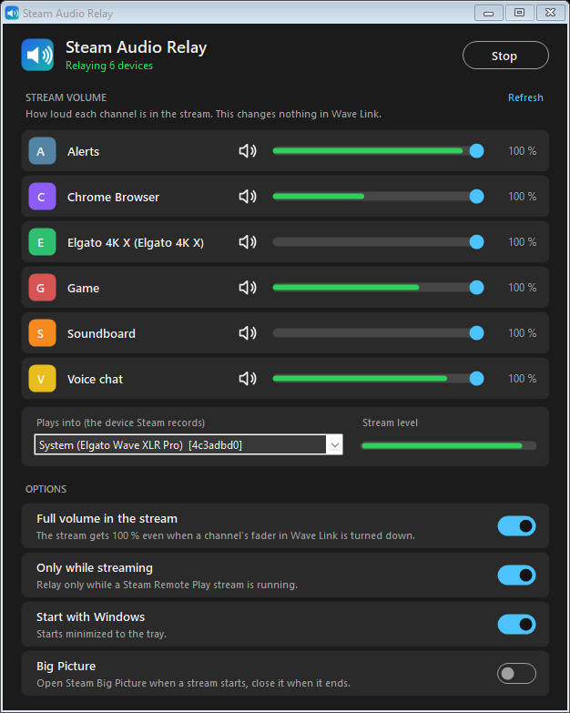
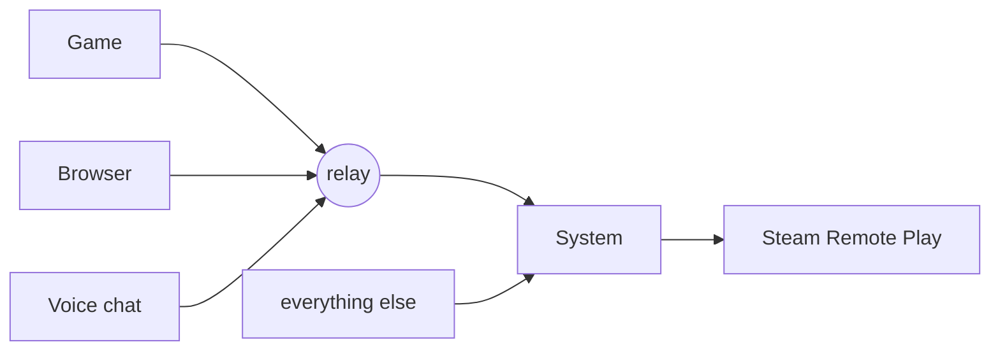

# steam-audio-relay

Steam Remote Play streams the sound of exactly one Windows playback device. If you use Elgato Wave Link, that device is the "System" channel. So on your Steam Deck, phone or TV you get system sounds and nothing else: no game, no browser, no voice chat.

This tool fixes that. It sits in the tray, notices when a Remote Play stream starts, and plays all your other Wave Link channels into the device Steam records. When the stream ends, it stops. You don't have to touch your Wave Link mixes.



## Quick start

1. **Get the tool.** Download the zip from the [Releases](https://github.com/dev-kalleno/steam-audio-relay/releases/latest) page, unpack it anywhere and start `steam-audio-relay.exe`. The exe isn't signed, so Windows SmartScreen will probably ask once ("More info", then "Run anyway"). If you'd rather not run a stranger's exe, [build it yourself](#build-it-yourself) with one command.
2. **Wave Link: keep "System" as the Windows default.** In Wave Link's settings, under audio devices, there is a lock for the system devices. Switch it on and set the output device to "System". Without the lock, Steam changes the Windows default to its own "Steam Streaming Speakers" when a client connects, and every program that has no Wave Link channel goes silent.
3. **In the tool: check the target and switch on "Start with Windows".** "Plays into" should show your Wave Link "System" device. It is picked for you if there is only one device with that name.

That's it. Leave Steam's audio channel setting for Remote Play on Automatic (see [below](#if-something-is-wrong) if you changed it). Connect from your Deck or phone. Within about a second the line under the title turns green and says "Relaying 6 devices" (or however many channels you have).

## The window

| Part | What it does |
| --- | --- |
| Start / Stop | Switches the relay on and off by hand. It starts by itself when you open the tool. |
| Stream volume | One row per Wave Link channel, with a mute button, a slider and a level meter inside the slider. This sets how loud that channel is **in the stream**. It changes nothing in Wave Link. |
| Refresh | Reads the device list again, for example after you added a channel in Wave Link. |
| Plays into | The device Steam records. Normally "System". |
| Stream level | The finished mix going to Steam. If this moves, the tool is doing its job. |
| Full volume in the stream | The stream gets full level even if you turned a channel down in Wave Link. See [Volume](#volume). On by default. |
| Only while streaming | Relay only while a Remote Play stream is running. On by default. Off means it relays all the time. |
| Start with Windows | Starts the tool with Windows, minimized to the tray. No admin rights needed. |
| Big Picture | Opens Steam Big Picture on the PC when a stream starts, reopens it after you quit a game, and closes it 20 seconds after the stream has ended. Off by default. |

Closing the window only hides it. The tool keeps running in the tray, and "Exit" in the tray icon's menu quits it.

## Volume

There are two places with a "Game" slider, and they do different things:

| Control | Changes the stream | Changes what you hear at the PC |
| --- | --- | --- |
| Slider or mute in this tool | yes | no |
| Channel fader in Wave Link | no (yes if "Full volume in the stream" is off) | yes |
| Levels inside a Wave Link mix (Personal Mix, Stream Mix) | no | yes |

So you can turn the game down at your desk to hear voice chat, and the TV in the living room still gets it at full level. That is what "Full volume in the stream" is for: the tool reads how far each channel is turned down in Wave Link and turns it back up by the same amount.

I measured this with a test tone on the Game channel. With the Wave Link fader at 100 %, 50 % and 20 %, the stream got exactly the same level each time.

Two details:

- The correction goes up to +30 dB. A fader that is almost at zero will still be quieter in the stream.
- I haven't tested a channel that is muted in Wave Link. It is probably silent in the stream too.

## Good to know

- **Stereo only.** The "System" device is a stereo device, so the stream is stereo. I looked for a way to get surround through and didn't find one.
- **Starting a game from the client's library** makes Steam end the stream and start a new one 5 to 10 seconds later. The relay pauses for that gap and comes back by itself.
- **About 50 ms delay** is added to the relayed channels.
- **At the PC, relayed channels play twice while a stream runs.** The relay plays them into "System", and "System" is usually part of the mix on your headphones too. The stream gets everything once. It only matters if someone sits at the PC while you stream from it.
- **Steam Broadcast** records the same device, so the relay runs during a broadcast as well.
- **Without Wave Link** the window lists every other playback device, muted, and you unmute the ones you want. I haven't tested that setup.

## If something is wrong

**Connected, but the tool keeps saying "Waiting for a Remote Play stream".**
The target is not the device Steam records. While a stream runs, look into `Steam\logs\streaming_log.txt` for a line like this and pick that device under "Plays into":

```
[System Windows] Recording on device: System (Elgato Wave XLR Pro)
```

**It says "Relaying", but a channel is missing in the stream.**
Check that channel's row in the tool: is it muted or turned down, and does its meter move while the program plays? If the meter stays flat, the program isn't playing on that Wave Link channel. If the channel has no row at all, click "Refresh".

**A game started through the stream is silent, everything else works.**
This only happens if you changed Steam's audio channels for Remote Play to surround. I had set 7.1 on the PC and on the Deck because it sounded like a good idea. Steam then sends a freshly started game to its 8-channel "Steam Streaming Speakers", Wave Link moves it to a stereo channel, and the game ends up with an 8-channel stream on a stereo device. That produces silence and no error. Set it back to Automatic (or Stereo) on both sides and it works. The stream is stereo anyway, so you lose nothing. A game that is already running when you connect doesn't have this problem.

**Programs without a Wave Link channel go silent when a client connects.**
That is step 2 of the quick start. The lock is off and Steam has changed the Windows default device.

**There are two devices called "System".**
Wave Link can keep a dead, greyed-out one around. Pick the live one. The short id in brackets tells them apart.

**Steam Link VR or SteamVR has no sound.**
Not this tool's fault, but it happened to me along the way: Wave Link's device visibility list had hidden "Steam Streaming Microphone", and SteamVR refuses to start audio without it. Switch it back on in Wave Link's settings.

**Anything else.**
The tool writes `steam-audio-relay.log` next to the exe. It says when a stream was detected, which devices are relayed and which were skipped and why.

## How it works

Wave Link gives every channel its own Windows playback device and routes your programs to them. Steam records only the Windows default device, which is "System", so the other channels never reach the stream.



The tool copies what the other channel devices are playing (WASAPI loopback), mixes it and plays the result into "System". It takes the channels before Wave Link's mixer, so nothing can loop back into itself.

To know when to run, it asks Windows twice a second whether `steam.exe` is recording the target device right now. That is the case from the moment a client connects until it disconnects, also while you alt-tab or switch between desktop and game. The relay starts about a second after you connect and pauses 3 seconds after Steam stops recording. I logged this for 25 minutes next to Steam's own log, with several connects, disconnects, alt-tabs and game starts, and every change matched. If Windows can't be asked, the tool falls back to reading Steam's streaming log.

<details>
<summary>Things that did not make Steam record anything other than "System"</summary>

Listed here so you don't have to try them yourself:

- sending a Wave Link mix to "Steam Streaming Speakers"
- changing the Windows default device
- editing `DefaultAudioDevice` in Steam's `localconfig.vdf` (Steam writes it back at start)
- reinstalling Steam's streaming audio drivers
- un-hiding Steam's devices in Wave Link

</details>

## Build it yourself

Everything is in one file, `relay.cs`, with no dependencies. `build.cmd` compiles it with the C# compiler that ships with Windows 10 and 11, so you don't need to install anything:

```
.\build.cmd
```

You get `steam-audio-relay.exe` (the window) and `steam-audio-relay-cli.exe` (for the terminal). The icon comes from `make-icon.ps1`, in case you want other colors.

## Command line

The window is all most people need. If you prefer a terminal:

```
.\steam-audio-relay-cli.exe --list
.\steam-audio-relay-cli.exe --target "{your-device-id}"
```

| Option | Meaning |
| --- | --- |
| `--list` | show playback devices and their ids |
| `--target <id>` | device to play into. Not needed if exactly one device is called "System". |
| `--source <id,id>` | devices to copy from. Default: all other devices of the target's driver. |
| `--always` | don't wait for a stream, relay until closed |
| `--raw` | don't undo the Wave Link faders (the opposite of "Full volume in the stream") |
| `--verbose` | log the level every 5 seconds |
| `--selftest` | open the devices, run for 2 seconds, exit |
| `--minimized` | window version only: start in the tray |

Settings from the window are stored in `%APPDATA%\steam-audio-relay\settings.ini`.

## Tested on

Only my own setup: Windows 11, Wave Link 3.5 (beta), an Elgato Wave XLR Pro and the Steam beta client. Clients were a Steam Deck, an iPhone with Steam Link and a MacBook. Other setups may behave differently, so tell me if yours does.

## License

MIT, see [LICENSE](LICENSE).
